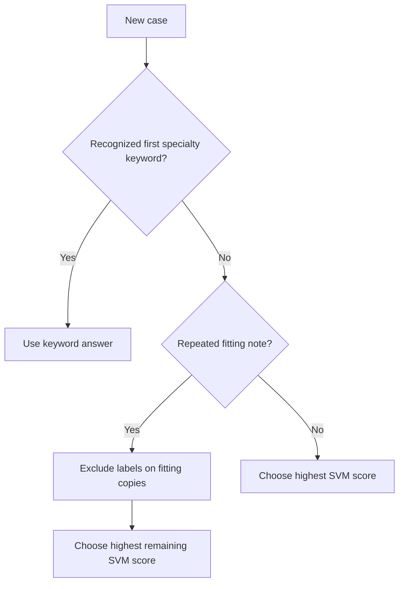

# 3. What each model and rule does

A **model family** is a type of learner. A **configuration** is one particular choice of its inputs and settings. A **full system** combines a fitted model with any selected rules.

## First, turn words into numbers

A classifier cannot directly calculate with a paragraph. We represent the paragraph as numbers, called features.

**TF-IDF** gives more weight to useful words and less weight to words common across many fitting cases. A feature could be “shoulder,” the two-word phrase “shoulder repair,” or a short character fragment.

The vocabulary and TF-IDF weights are learned using fitting text. A **word bigram** is two consecutive words; a **character n-gram** is a short sequence of letters. Our character features stay within word boundaries, with padding.

## The six families

| Model | Plain-English idea | Why it is in our comparison |
| --- | --- | --- |
| Naive Bayes | Combine evidence from word frequencies for each class | Recreates the assignment's weak description-only baseline |
| Word TF-IDF + logistic regression | Learn which weighted words and phrases favour each specialty | A simple, strong lexical comparison |
| Field word/character SVM | Learn class boundaries using words and letter fragments from each field | Tests useful phrases, spelling fragments and separate fields |
| LSA + logistic regression | Compress a large word vector into 128 broader numerical patterns, then classify | Tests a compact learned representation |
| Frozen MiniLM + logistic regression | Use a pretrained encoder to make text vectors, then train a small classifier | Tests pretrained representations without changing the encoder |
| Fine-tuned ClinicalBERT | Start with a clinically pretrained language model and adapt all its parameters | Tests a more expensive pretrained approach |

### The SVM that we submit

SVM means **support vector machine**. Think of it as learning boundaries between categories in a space of word features.

It keeps description, procedure name and transcription separate. Each gets word and character features. Then the features are joined for classification.

The chosen settings are **C=0.3**, **balanced class weights**, **clinical inputs**. C controls how strongly fitting errors compete with keeping the model simple. Balanced weights give small classes more influence.

An SVM's score is a ranking margin. It is not automatically a probability. The highest remaining score determines the model's answer.

### MiniLM: frozen means unchanged

MiniLM reads chunks of at most 220 tokens. A token is a text piece and may be part of a word.

For each field, we average the chunk vectors and normalize that average. Four 384-number field vectors become a 1,536-number case vector. Empty fields also receive an encoder vector.

MiniLM's pretrained weights stay fixed. We train only the logistic classifier on the course labels. This lets it cover long notes without fine-tuning the language encoder.

### ClinicalBERT: fine-tuned means adapted

ClinicalBERT's pretrained weights are updated for our 12-class task. It is not trained from scratch.

We compare:

- **Head:** first 510 word pieces plus two special tokens.
- **Head+tail:** first 128 and last 382 word pieces plus two special tokens.

The second option retains the end of long notes, which may contain conclusions or plans. Validation chooses a checkpoint during three epochs. An epoch is one pass through the fitting cases.

It trains on the Apple GPU when available. Two small batches of up to eight cases form an effective batch of up to 16. The final smaller batch is also used, with correct loss weighting.

## The two rules

### Keyword rule

If the first original keyword says “orthopedic,” predict Orthopedic. This uses a supplied input, rather than the unknown target label.

We test a fixed specialty-name mapping and a mapping learned from fitting data. The learned version needs at least two examples and 95% agreement for a keyword.

The selected `both` policy uses the **fixed** mapping. Having code for a learned alternative does not mean that alternative was submitted.

### Repeated-note exclusion

Suppose a fitting copy of a note was labelled Orthopedic. This corpus usually files another copy under a different specialty. The rule excludes Orthopedic, then chooses the strongest remaining model score.

It does **not** copy the old answer, know the correct new answer, or guarantee success. It can fail when the label repeats or when the remaining scores favour another wrong class.

## How the final system decides

The code can compute scores and exclusion before applying the keyword override. The resulting decision priority is keyword first, repeated-note exclusion second, ordinary model decision otherwise.

## Why create more training examples?

Small classes have fewer examples. We compare three ways to give them more influence or variety:

| Method | What happens | What it tests |
| --- | --- | --- |
| Resampling | Repeat existing minority cases | Whether simply seeing them more often helps |
| Dropout | Use the same sampling counts, but remove some fields | Whether training with missing fields helps |
| Section recombination | Replace a headed section with one from another fitting case of the same class | Whether added wording variety helps |

All donors stay inside the fitting fold. Shared class does not ensure medical consistency: an eye-operation title can be paired with a section describing a different eye operation.

The selected final system uses **no augmentation**. We performed the required experiments, but validation did not select an augmented winner.
