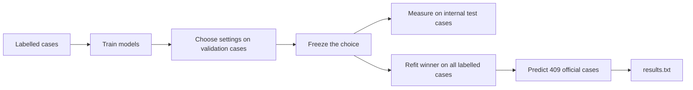

# Start here: understand our project

This guide is for someone who has not studied the code yet. Read the short lessons first. Use the file index when you need to look up a particular file.

**Our job:** read a clinical case and choose one of 12 medical specialties.

**Our research question:** do word-based models or pretrained language models work better, and how does the answer change when specialty clues or repeated notes are available?

**Our final system:** a word/character SVM plus a keyword rule and a repeated-note rule. BERT and MiniLM are comparison models.

## Reading order

| Read | What you will understand |
| --- | --- |
| [1. The project in plain English](01_PROJECT.md) | What we are trying to do and what the professor requires |
| [2. Data and fair evaluation](02_DATA_AND_EVALUATION.md) | What a case contains; training, validation and testing |
| [3. Models and rules](03_MODELS_AND_RULES.md) | What each model does and how the final decision is made |
| [4. Results and the answer](04_RESULTS_AND_QUESTION.md) | What the numbers mean and how they answer the question |
| [5. Every written document](05_DOCUMENTS_AND_PAPER.md) | What each existing guide and paper file is for |
| [6. Every code tool](06_CODE_TOOLS.md) | What all 21 Python modules and both launchers do |
| [7. Running it and defending it](07_RUN_AND_DEFENSE.md) | Correct commands for this folder and simple practice answers |
| [8. Words and software explained](08_GLOSSARY_AND_SOFTWARE.md) | A glossary and the purpose of every pinned Python package |
| [9. Every project file](09_FILE_BY_FILE.md) | A searchable entry for every existing project file, including saved experiments and logs |

For a first 30-minute session, read lessons 1–4 and the practice questions in lesson 7. You can then explain the main idea before learning the implementation.

## The five facts everyone should know

1. We have **2,613 usable labelled cases** after dropping three corrupt records.
2. Each experiment separates **1,672 fitting**, **418 validation**, and **523 internal test** cases.
3. The final choice is an **SVM with rules**, selected using validation results.
4. On the random internal test, it gets **95.79% accuracy**, **0.9402 macro-F1**, and **0.80 minimum class F1**.
5. The official **409 cases have no supplied answers**. We generate `results.txt` for them; we cannot report their accuracy.

## A quick picture

The internal test measures the frozen choice. It does not tell us which choice to make.

These are study notes, separate from the submitted paper. They explain the current saved project as reviewed on 8 October 2026. Existing code, models and reported scores were not changed to create them.
