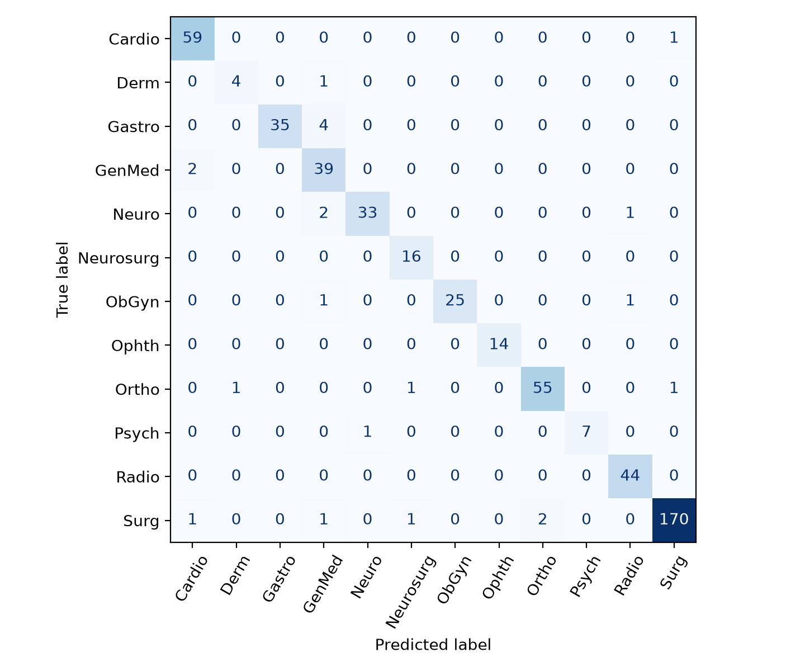

# Specialty classification: representations, metadata, and repeated notes

**Group XXX** — Author 1 (xx%), Author 2 (xx%), Author 3 (xx%), Author 4 (xx%) ⚠ *mandatory: names and % contribution of each member*

## Introduction

We classify clinical cases into 12 specialties for the course task [6]. Our research question is: **How do lexical and pretrained representations compare when specialty metadata is available versus absent, and when notes are repeated versus unseen?** We separate model predictions from keyword and duplicate-label rules, because aggregate success may depend on corpus structure as well as clinical language.

## Data

### Data Analysis

The supplied training set contains 2,616 records. Three corrupted records with invalid labels and empty clinical fields are logged and excluded, leaving 2,613. Surgery has 876 cases versus Dermatology's 25 (35:1); 441 cases lack keywords and 30 lack transcriptions.

Two inspected patterns guide our experiments. First, 2172 keyword lists begin with a recognizable specialty (e.g., `orthopedic`), agreeing with 2171 supplied labels. Second, 711 cleaned note groups have conflicting labels: “Left lower extremity venous Doppler ultrasound” appears in Cardiovascular-Pulmonary and Radiology. Identical cleaned three-field clinical tuples impose an empirical deterministic label-matching ceiling of 70.3% on this corpus; differing keywords can resolve this ambiguity. Copies almost never repeat a label: in 710 of 712 cleaned note groups with several rows, every copy carries a different specialty. Cleaning removes embedded records from seven oversized descriptions and normalizes section separators.

### Data Augmentation

For Dermatology, Psychiatry-Psychology, Ophthalmology and Neurosurgery, we target about 150 cases per class, adding at most four variants per original. We compare resampling, matched field dropout, and section recombination. Dropout removes keywords, sample name with probability .5, and transcription with probability .35 when a description remains. Recombination replaces each eligible section with probability .5, drawing the same header from another fitting case of the same specialty. Donor pools are rebuilt within each fitting fold; all base/donor ids are saved. Shared specialty does not guarantee coherent synthetic histories.

## Models

Six families address the research question. The official **Naive Bayes baseline** uses lowercased, Porter-stemmed description TF-IDF and Multinomial NB (α=1). **Word TF-IDF + logistic regression (LR)** tests lexical evidence; **field word/character support vector machine (SVM)** concatenates normalized features per field to capture phrases and spelling fragments. **Latent semantic analysis (LSA) + LR** uses a 128-dimensional TF-IDF projection. **Frozen MiniLM + LR** averages normalized nonoverlapping 220-token chunk embeddings, renormalizes each field mean and concatenates four 384-dimensional vectors; empty fields use the empty-text embedding [1–3]. **ClinicalBERT** is fully fine-tuned [4]: head-only retains 510 word pieces; head+tail keeps the first 128 and last 382, plus special tokens.

Inputs either omit keywords, remove their first specialty clue, or retain all keywords. Separate rules use a fixed specialty mapping or a fitting-only mapping (≥2 observations, ≥95% purity); duplicate-label exclusion removes specialties already attached to fitting copies of a repeated note before choosing the remaining model score. Keyword decisions take precedence. Duplicate exclusion is a corpus hypothesis, not a clinical guarantee.

## Experimental Setup

Random partitions permit repeated notes across boundaries; grouped partitions keep each cleaned normalized note together, using clinical fields for empty notes. Both stratify by label. The first outer and first inner development folds of seeded five-fold divisions yield random train/validation/test 1672/418/523 and grouped 1672/418/523, with all classes present. All compared models fit the same training rows. Development selects configurations, checkpoints and rules by macro-F1, then minimum class F1, then accuracy. The submission uses the declared random development winner, frozen before outer scoring and refitted on all valid labeled cases.

Earlier runs explored labeled data and inspected unlabeled official inputs; this is a retrospective rerun, not new external confirmation. The merged analysis uses labeled cases only, and official inputs are loaded solely for final prediction. `results.txt` is produced on the professor's cleaned test set (398 rows), released after the first set: it removes 11 broken rows (four oversized records, their four overflow lines, an empty row, a blank row and a row with shifted fields) and leaves every other row unchanged, so the frozen system's predictions for the remaining notes are identical. The training file was not re-issued; its three invalid records and seven oversized descriptions are handled as described in Data Analysis. Accuracy, macro-F1 and per-class precision/recall/F1 are computed with scikit-learn [5].

### Parameters/Hyperparameters

Partition/model seeds are 20261008/42. Inverse regularization C is .3/1/3 for SVM and 1/10 for LR; ordinary/balanced weights are compared (LSA balanced). SVM word 1–2-grams have min_df=2 and ≤40,000 features per field; character word-boundary 3–5-grams have min_df=3 and ≤30,000. Word LR/LSA use word 1–2-grams, min_df=2 and ≤60,000 features. These comparators use sublinear TF and L2 normalization; the reference uses TF-IDF defaults. BERT uses AdamW, learning rate 3e-5, weight decay .01, 10% warm-up, square-root inverse-frequency class weights, three epochs, and ≤512 tokens. Effective batches ≤16 accumulate microbatches ≤8 with exact weighted normalization, including partial batches. Pinned revisions, versions and full configurations accompany the code; computation uses M4/16 GB.

## Results

Table 1 compares development-selected bare models, removing the first specialty keyword (the reference uses description only).

| Model | Random acc. | Random macro-F1 | Grouped acc. | Grouped macro-F1 | Mem. rate |
| --- | --- | --- | --- | --- | --- |
| Naive Bayes baseline | 36.5% | 0.099 | 40.7% | 0.143 | 0.52 |
| Word TF-IDF + LR | 46.7% | 0.502 | 57.2% | 0.594 | 0.72 |
| Field word/character SVM | 41.1% | 0.419 | 59.3% | 0.615 | 1.00 |
| LSA + LR | 51.8% | 0.542 | 54.7% | 0.565 | 0.49 |
| Frozen MiniLM + LR | 50.1% | 0.542 | 58.5% | 0.620 | 0.66 |
| Fine-tuned ClinicalBERT | 53.9% | 0.537 | 57.2% | 0.604 | 0.58 |

*Table 1. Common-partition model comparisons; F1 is macro-averaged. Mem. rate: share of the 190 random-test notes that repeat a fitting note for which the bare model outputs a specialty that note already carries in the fitting data.*

The submission choice is **Field word/character SVM** (C=0.3, balanced=True), input `clinical`, rules `both`: random test accuracy **95.8%**, macro-F1 **0.940**, minimum class F1 **0.800**. The independently selected grouped system achieves 93.5% accuracy and 0.914 macro-F1. Table 2 and Figure 1 describe the submission-selected system on the random test.

| Specialty | Train n | Test n | P | R | F1 |
| --- | --- | --- | --- | --- | --- |
| Cardiovascular-Pulmonary | 299 | 60 | 0.95 | 0.98 | 0.97 |
| Dermatology | 25 | 5 | 0.80 | 0.80 | 0.80 |
| Gastroenterology | 192 | 39 | 1.00 | 0.90 | 0.95 |
| General Medicine | 207 | 41 | 0.81 | 0.95 | 0.88 |
| Neurology | 181 | 36 | 0.97 | 0.92 | 0.94 |
| Neurosurgery | 78 | 16 | 0.89 | 1.00 | 0.94 |
| Obstetrics-Gynecology | 135 | 27 | 1.00 | 0.93 | 0.96 |
| Ophthalmology | 71 | 14 | 1.00 | 1.00 | 1.00 |
| Orthopedic | 292 | 58 | 0.96 | 0.95 | 0.96 |
| Psychiatry-Psychology | 40 | 8 | 1.00 | 0.88 | 0.93 |
| Radiology | 217 | 44 | 0.96 | 1.00 | 0.98 |
| Surgery | 876 | 175 | 0.99 | 0.97 | 0.98 |

*Table 2. Full training distribution and internal-test support, precision (P), recall (R) and F1.*

*Figure 1. Rows: gold; columns: predicted. Cardio=Cardiovascular-Pulmonary; Derm=Dermatology; Gastro=Gastroenterology; GenMed=General Medicine; Neuro=Neurology; Neurosurg=Neurosurgery; ObGyn=Obstetrics-Gynecology; Ophth=Ophthalmology; Ortho=Orthopedic; Psych=Psychiatry-Psychology; Radio=Radiology; Surg=Surgery.*

| SVM input / rules | Random F1 | Grouped F1 |
| --- | --- | --- |
| No keywords | 0.399 | 0.610 |
| First specialty keyword removed | 0.419 | 0.615 |
| All keywords | 0.885 | 0.911 |
| No keywords + keyword rule | 0.896 | 0.920 |
| No keywords + duplicate rule | 0.702 | 0.610 |
| No keywords + both rules | 0.945 | 0.920 |

*Table 3. Metadata/rule ablations. Each input condition tunes SVM settings on bare development macro-F1; the last three rows share the no-keywords model. The submission tunes the full system, so its configuration can differ. Rules inspect original keywords even when model features omit them.*

## Discussion

The research question has two parts. For representation, LSA + LR and Frozen MiniLM + LR attain the highest random bare scores (within .001). Fine-tuning does not consistently lead: ClinicalBERT reaches macro-F1 0.537 on random and 0.604 on grouped partitions, against 0.419 and 0.615 for the SVM. For repeated versus unseen notes, a repeated note is the *hardest* case, not the easiest: 190 of 523 random-test notes repeat a fitting note, and for 189 of them the gold specialty is one the note does not yet carry. Bare models reproduce the fitting copy's label for 49%–100% of these notes (Table 1). The SVM does so for all of them (accuracy 0.0% on repeated vs 64.6% on unseen notes), which explains why every model scores lower on random than on grouped partitions. Memorisation and generalisation are separate: the SVM memorises most and is still among the best on unseen notes. For metadata, Table 3 shows its contribution; removing only the first clue still retains other keyword evidence. The selected system routes are keyword: 444 cases, 100.0% accuracy; memory: 25 cases, 76.0% accuracy; model: 54 cases, 70.4% accuracy. Its success combines classification with metadata and corpus structure; transfer to hospital data lacking those clues is unproven.

Augmentation diagnostics pool three-fold predictions on outer training/development cases using previously selected SVM settings. Changes in macro-F1 are random resample: Δ macro-F1 +0.004; random dropout: Δ macro-F1 -0.011; random sections: Δ macro-F1 +0.003; grouped resample: Δ macro-F1 +0.008; grouped dropout: Δ macro-F1 -0.016; grouped sections: Δ macro-F1 +0.006. Matched resampling separates sampling weight from dropout; fold-local donors prevent heldout-section leakage. In an inspected variant of Ophthalmology source 1110, an eyelid-repair title is retained while donor 1143 supplies lens-removal procedure text: label preservation does not ensure consistency. These post-selection diagnostics are descriptive, and minority F1 is unstable. Full tables and synthetic examples accompany the draft.

The largest residual confusion is Gastroenterology → General Medicine (4 of 22 errors). Across models the dominant bare error is a *Surgery* note predicted as an organ specialty (129 of 224 ClinicalBERT and 95 of 213 SVM grouped-test errors), where the duplication described in Data Analysis makes both labels defensible. Four actual selected-system mistakes illustrate the limitations:

- **Random test, source record 361**: “I was asked to see the patient for C. diff colitis.” Predicted **General Medicine**, supplied label **Gastroenterology**. Keywords are absent. Despite the explicit gastrointestinal consultation, the model chooses a broad category. The long admission history and general consultation language may obscure the specialty-specific cue; this is the most frequent confusion pair (four cases).
- **Random test, source record 2582**: “Primary right shoulder arthroscopic rotator cuff repair with subacromial decompression.” Predicted **Orthopedic**, supplied label **Surgery**. Keywords are absent. The shoulder procedure strongly overlaps Orthopedic and Surgery, but the supplied category is the broader Surgery. Anatomical specificity does not reliably identify this corpus's single specialty label.
- **Random test, source record 771**: “Left third digit numbness and wrist pain.” Predicted **Radiology**, supplied label **Neurology**. A fitting copy is labeled Orthopedic. Duplicate exclusion removes that label, then selects Radiology rather than Neurology. Its procedure name, “MRI C3 - Cord Compression.”, cues imaging; eliminating a known label cannot identify the correct remaining specialty.
- **Random test, source record 1480**: “This is a 69-year-old white woman with Huntington disease, who presents with the third suicide attempt in the past two months.” Predicted **Neurology**, supplied label **Psychiatry-Psychology**. Keywords are absent and no fitting copy exists, so the model decides. The note is a psychiatric consult (“suicide” 11 times, “depression” 10 times) about a neurological disease, and the corpus files the same note twice: source 858 as Neurology and source 1480 as Psychiatry-Psychology. Any single prediction is wrong for one of the two copies.

These readings do not establish that supplied labels are wrong. Paired note-group bootstrap estimates compare BERT with SVM; they are not equivalence tests. The selected random system's conditional 95% macro-F1 interval is [0.897, 0.969]. Prior exploration and selection uncertainty are excluded, and exact grouping misses near-duplicates. Official performance remains unknown.

## Future Work

Repeat across outer folds/seeds; test clinically coherent augmentation, whole-note encoding and multi-label targets for overlapping specialties. Evaluate a calibrated lexical/neural ensemble if development evidence supports it.

## Bibliography

[1] Reimers and Gurevych (2019). [Sentence-BERT](https://arxiv.org/abs/1908.10084).

[2] Wang et al. (2020). [MiniLM](https://arxiv.org/abs/2002.10957).

[3] Sentence Transformers. [all-MiniLM-L6-v2 model card](https://huggingface.co/sentence-transformers/all-MiniLM-L6-v2).

[4] Alsentzer et al. (2019). [Publicly Available Clinical BERT Embeddings](https://aclanthology.org/W19-1909/); [Bio_ClinicalBERT checkpoint](https://huggingface.co/emilyalsentzer/Bio_ClinicalBERT).

[5] Pedregosa et al. (2011). [Scikit-learn](https://jmlr.org/papers/v12/pedregosa11a.html).

[6] Course assignment and supplied template (2026); supplied corpus adapted from Kaggle. No external labeled cases were added.

Software: Python, NumPy, pandas, SciPy, scikit-learn, NLTK, Matplotlib, PyTorch, Transformers and Sentence Transformers (versions/revisions supplied).

**LLM declaration:** Claude assisted earlier design, code and drafting. OpenAI Codex reviewed both runs, merged/corrected code, executed experiments, inspected data/errors and drafted this paper. Metrics come from saved predictions; neither assistant supplied case predictions or generated synthetic clinical assertions. The group should amend this declaration to reflect actual review and contributions.

## Appendix A: Extra Figures and Tables

*Table A1. Augmentation diagnostics (three-fold pooled predictions on outer training/development cases).*

| Regime | Augmentation | Acc. | Macro-F1 | Minority mean F1 |
| --- | --- | --- | --- | --- |
| random | none | 43.2% | 0.441 | 0.440 |
| random | resample | 43.2% | 0.445 | 0.451 |
| random | dropout | 43.2% | 0.430 | 0.405 |
| random | sections | 43.0% | 0.444 | 0.450 |
| grouped | none | 59.3% | 0.608 | 0.618 |
| grouped | resample | 59.5% | 0.616 | 0.638 |
| grouped | dropout | 58.9% | 0.592 | 0.566 |
| grouped | sections | 59.4% | 0.614 | 0.633 |

*Table A2. Memorisation on the random test (bare models).*

| Model | Mem. rate | Acc. repeated | Acc. unseen |
| --- | --- | --- | --- |
| Naive Bayes baseline | 0.52 | 0.332 | 0.384 |
| Word TF-IDF + LR | 0.72 | 0.247 | 0.592 |
| Field word/character SVM | 1.00 | 0.000 | 0.646 |
| LSA + LR | 0.49 | 0.426 | 0.571 |
| Frozen MiniLM + LR | 0.66 | 0.279 | 0.628 |
| Fine-tuned ClinicalBERT | 0.58 | 0.353 | 0.646 |

*Figure A1. Grouped-test confusion matrix of the separately selected grouped system.*

**Formatting:** English Markdown working draft. Final submission requires the supplied template, ≤3 main pages, bibliography allowance and ≤1 appendix page; group-supplied names/contributions and pagination require final checking.
