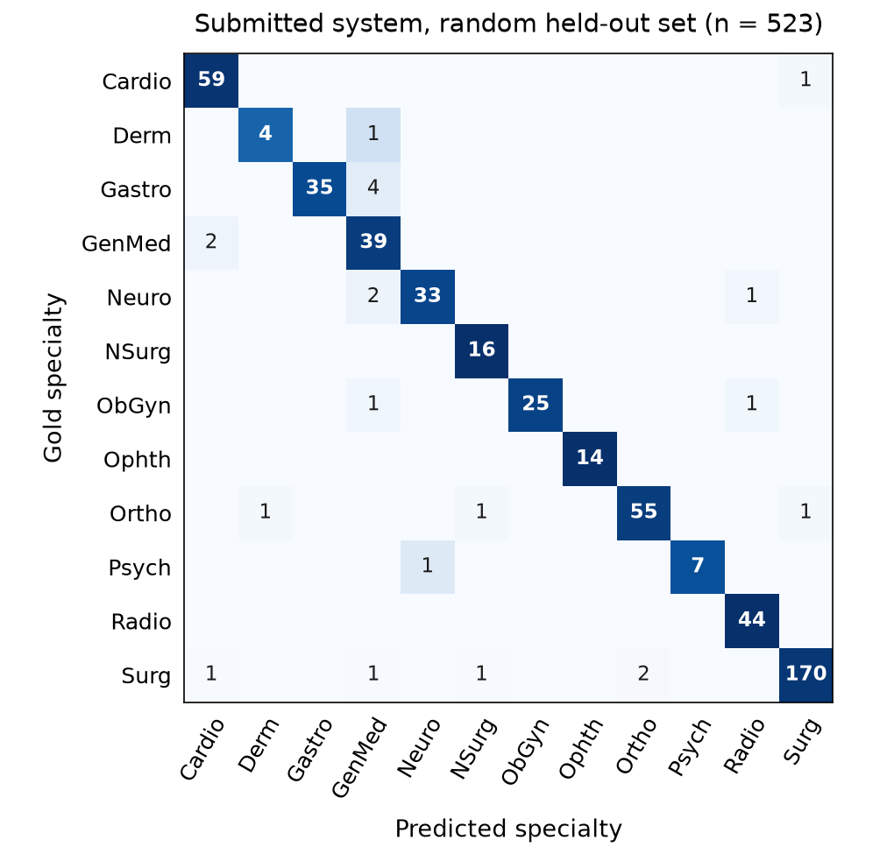
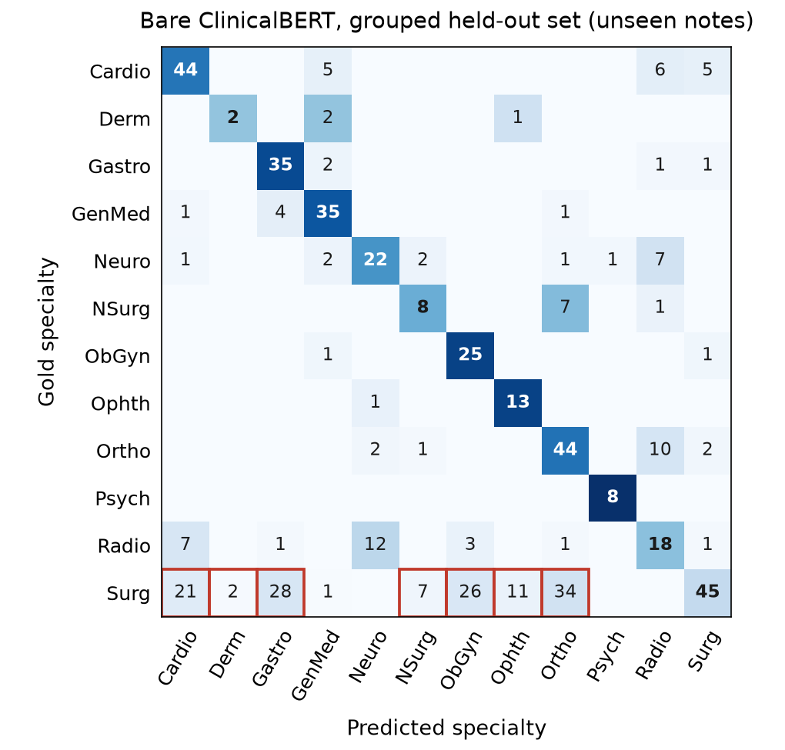

<!--
WORKING DRAFT for the LaTeX conversion (template: StudentsPack-v2/Project-Template/template.tex).
- Every number comes from ../artifacts/ (saved predictions and metrics); see ../IMPROVEMENTS.md.
- Figures are in ./figures/, references in ./references.bib (BibTeX keys in [brackets] below).
- Before submitting: fill the author line; keep the main text ≤ 3 pages (bibliography excluded);
  appendix ≤ 1 page; delete the template's "Evaluation and tips" section.
- ../paper/draft.md is the auto-generated version of this text (src/report.py); THIS file is the one to edit.
- DECISIONS.md (same folder) = full decision story + likely oral questions; not part of the paper, not zipped.
-->

# Specialty Classification of Clinical Notes: Representations, Metadata and Repeated Notes

**Group XXX** — Author 1 (xx%), Author 2 (xx%), Author 3 (xx%), Author 4 (xx%) ⚠ *mandatory: names and % contribution of each member*

## 1 Introduction

We classify clinical notes into 12 medical specialties from their description, sample name, transcription and
keywords. Inspecting the training data showed that a high score does not have to come from reading
the clinical text: the first keyword usually names the specialty, and many notes are verbatim copies of other
notes filed under a different specialty. Our research question is therefore: **How do lexical and pretrained
representations compare when specialty metadata is available versus absent, and when notes are repeated versus
unseen?** We keep model predictions separate from two explicit rules (a keyword rule and a duplicate rule), so
that we can see what each part contributes. In short, the keywords and the duplicates explain most of the high
scores; on new notes, all models apart from the description-only baseline, from word counts to ClinicalBERT, reach
a similar macro-F1 (0.57–0.62), and the largest share of the remaining errors comes from specialties that overlap.

## 2 Data

### 2.1 Data Analysis

The training file contains 2,616 records. Three records carry note fragments instead of a label and have empty
clinical fields; they are logged and excluded, leaving 2,613. The classes are imbalanced: *Surgery* has 876
cases and *Dermatology* 25 (35:1). 441 cases have no keywords and 30 have no transcription.

Two observations guide the experiments. **(1) Specialty-naming keywords:** 2,172 keyword lists begin with a
specialty name (e.g. `orthopedic`), and it agrees with the supplied label in 2,171 of them. **(2) Repeated
notes with different labels:** 711 cleaned note groups carry conflicting labels; for example, the report "Left
lower extremity venous Doppler ultrasound" appears under both *Cardiovascular-Pulmonary* and *Radiology*. Copies
almost never repeat a label: in 710 of the 712 groups with several rows, every copy has a different specialty.
Consequently, on the labelled data, a system that gives identical clinical text (description, sample name,
transcription) a single label can reach at most 70.3% accuracy; only differing keywords can separate such copies. **(3) Formatting faults:** seven descriptions swallowed
other records (a quoting fault); cleaning cuts them at the first embedded record and normalises the `.,` section
separators, identically for training and test inputs.

### 2.2 Data Augmentation

We augment the four smallest classes (*Dermatology*, *Psychiatry-Psychology*, *Ophthalmology*, *Neurosurgery*)
towards about 150 cases each, adding at most four variants per original note. Three strategies are compared:
**resampling** (duplicating originals), **field dropout** (removing the keywords, the sample name with
probability 0.5, and the transcription with probability 0.35 when a description remains), and **section
recombination**: each headed section of a note (e.g. PROCEDURE, IMPRESSION) is replaced, with probability 0.5,
by the same-header section of another training note of the same specialty. Donors come only from the training
fold, so no held-out text enters training.

## 3 Models

Since the research question compares lexical and pretrained representations, we chose six models, following the
course lectures [coheur2026], that form a ladder from pure word counts to a fine-tuned clinical language model; each step adds one ingredient.
The **Naive Bayes baseline** (TF-IDF of the lowercased, Porter-stemmed description, Multinomial NB, α = 1) is the
official reference point that every model must beat.
**Word TF-IDF + logistic regression (LR)** is the standard sparse text classifier: it shows how far plain word
evidence from all fields goes.
The **word/character SVM** adds character 3–5-grams per field, because clinical vocabulary is built from parts
(*-ectomy*, *-itis*, *-oscopy*) and spelling varies; linear SVMs also suit very large sparse inputs.
**LSA + LR** compresses the TF-IDF vectors into 128 dense dimensions learned from our own notes, to test whether
grouping related words generalises better than exact words.
**Frozen MiniLM + LR** [reimers2019, wang2020, minilmcard] adds knowledge from large general-domain pretraining
without any fine-tuning; it reads whole notes by averaging 220-token chunks, one 384-dimensional vector per field.
**ClinicalBERT** [alsentzer2019], pretrained on clinical notes and fully fine-tuned, is the largest model we
fine-tune (108 M parameters) and the one closest to the domain; because 70.8% of the notes exceed its 512-token limit, it reads either the first 510 word pieces
(head) or the first 128 and last 382, where conclusions such as IMPRESSION and PLAN usually appear (head+tail).

Model inputs omit the keywords, remove only the first keyword, or keep them all. Two rules can sit on top of any
model: a **keyword rule** (a first keyword mapped to a specialty, from a fixed list or learned with ≥ 2
observations and ≥ 95% purity), which takes precedence, and a **duplicate rule** (for a verbatim copy of training
notes, exclude the specialties already attached to it and take the best remaining score). The duplicate rule
encodes a regularity of this corpus, not a clinical fact.

## 4 Experimental Setup

**How the design came about.** Two things we noticed in the data shaped the design. First, the first keyword names
the specialty in 2,171 of 2,172 rows. Left in the input, it would let a model score well without reading the note,
so we removed it and turned it into a separate rule whose effect we measure. Second, the same note is often filed
under several specialties, and a model that has seen one copy tends to repeat that copy's label. We therefore test
every model twice: on a *random* partition, where copies of a note can fall on both sides, and on a *grouped*
partition, where every held-out note is new. The remaining choices follow from the research question (the choice of models is explained in
Section 3). Section recombination is compared with plain resampling, to
tell new text apart from simply having more examples. Every choice is made on a validation part and frozen before
scoring the held-out set, so that its score is not biased by our choices. Finally, we submit the model that won on
validation, the SVM: ClinicalBERT scored lower (full-system macro-F1 0.952 vs. 0.969) and needed about 16 minutes of
GPU training per run instead of seconds.

**Partitions.** Both regimes are stratified by label; empty notes are grouped by their other clinical fields. The
first outer and first inner fold of seeded five-fold divisions give train/validation/held-out sizes of 1,672/418/523
per regime, with all classes present, and all models are fitted on the same training rows. Validation ranks
configurations, checkpoints and rules by macro-F1, then minimum class F1, then accuracy. The submitted system is
refitted on **all 2,613 valid training cases**.

**Held-out sets and official test set.** All scores in this paper come from our held-out sets, which are taken
from the labelled training file. The official test file (398 notes) has no labels; it is used only to produce
`results.txt`.

**Metrics.** Accuracy, macro-F1 and per-class precision, recall and F1 [pedregosa2011]; a paired bootstrap over
note groups gives 95% intervals.

### 4.1 Parameters/Hyperparameters

Partition and model seeds are 20261008 and 42. The inverse regularisation strength C is searched in {0.3, 1, 3}
for the SVM and {1, 10} for LR, with ordinary or balanced class weights. SVM word 1–2-grams use min_df = 2 and at
most 40,000 features per field; character 3–5-grams within word boundaries use min_df = 3 and at most 30,000.
Word LR and LSA use word 1–2-grams, min_df = 2, at most 60,000 features. All comparators use sublinear TF and L2
normalisation. Resulting input sizes: 114,257 sparse dimensions for the submitted SVM (about 3,200 non-zero per
note), 60,000 for word LR and 4,126 for the baseline; 128 (LSA) and 1,536 (MiniLM, 4 × 384) dense dimensions.
ClinicalBERT (BERT-base: 12 layers, 108 M parameters, all fine-tuned) reads at most 512 word pieces and classifies
a 768-dimensional [CLS] vector; it uses AdamW (learning rate 3e-5, weight decay 0.01), 10% warm-up, square-root
inverse-frequency class weights, 3 epochs and an effective batch of 16 (micro-batches of 8, partial batches
included). Model revisions are pinned; all runs used an Apple M4 with 16 GB.

## 5 Results

Table 1 compares the validation-selected bare models (first specialty keyword removed; the baseline uses only
the description).

| Model | Random acc. | Random macro-F1 | Grouped acc. | Grouped macro-F1 | Mem. rate |
| --- | --- | --- | --- | --- | --- |
| Naive Bayes baseline | 36.5% | 0.099 | 40.7% | 0.143 | 0.52 |
| Word TF-IDF + LR | 46.7% | 0.502 | 57.2% | 0.594 | 0.72 |
| Field word/character SVM | 41.1% | 0.419 | 59.3% | 0.615 | 1.00 |
| LSA + LR | 51.8% | 0.542 | 54.7% | 0.565 | 0.49 |
| Frozen MiniLM + LR | 50.1% | 0.542 | 58.5% | 0.620 | 0.66 |
| Fine-tuned ClinicalBERT | 53.9% | 0.537 | 57.2% | 0.604 | 0.58 |

*Table 1. Bare models on common partitions; F1 is macro-averaged. Mem. rate: among the 190 random held-out notes
that repeat a training note, the share for which the model outputs a specialty that note already carries in the
training data.*

The submitted system is the **field word/character SVM** (C = 0.3, balanced weights, keywords omitted from the
input) with **both rules**: random held-out accuracy **95.8%**, macro-F1 **0.940**, minimum class F1 **0.800** (95%
macro-F1 interval [0.897, 0.969]). The separately selected grouped system reaches 93.5% accuracy and 0.914
macro-F1. Table 2 and Figure 1 describe the submitted system on the random held-out set.

| Specialty | Train n | Held-out n | P | R | F1 |
| --- | --- | --- | --- | --- | --- |
| Cardiovascular-Pulmonary | 299 | 60 | 0.95 | 0.98 | 0.97 |
| Dermatology | 25 | 5 | 0.80 | 0.80 | 0.80 |
| Gastroenterology | 192 | 39 | 1.00 | 0.90 | 0.95 |
| General Medicine | 207 | 41 | 0.81 | 0.95 | 0.88 |
| Neurology | 181 | 36 | 0.97 | 0.92 | 0.94 |
| Neurosurgery | 78 | 16 | 0.89 | 1.00 | 0.94 |
| Obstetrics-Gynecology | 135 | 27 | 1.00 | 0.93 | 0.96 |
| Ophthalmology | 71 | 14 | 1.00 | 1.00 | 1.00 |
| Orthopedic | 292 | 58 | 0.96 | 0.95 | 0.96 |
| Psychiatry-Psychology | 40 | 8 | 1.00 | 0.88 | 0.93 |
| Radiology | 217 | 44 | 0.96 | 1.00 | 0.98 |
| Surgery | 876 | 175 | 0.99 | 0.97 | 0.98 |

*Table 2. Submitted system on the random held-out set: training size, held-out support, precision (P), recall (R), F1.*

*Figure 1. Confusion matrix of the submitted system on the random held-out set (rows: gold; columns: predicted; numbers:
counts; colour: share of the row). Cardio = Cardiovascular-Pulmonary, Derm = Dermatology, Gastro =
Gastroenterology, GenMed = General Medicine, Neuro = Neurology, NSurg = Neurosurgery, ObGyn =
Obstetrics-Gynecology, Ophth = Ophthalmology, Ortho = Orthopedic, Psych = Psychiatry-Psychology, Radio =
Radiology, Surg = Surgery.*

## 6 Discussion

**Answer to the research question.** The high scores come mostly from two shortcuts in the data, not from
reading the notes. When the specialty keyword is present, the keyword rule is almost always right. On new notes,
all representations reach a similar level and fine-tuning ClinicalBERT gives no clear gain. Repeated notes are the
hardest case of all.

**Pretrained versus word-based models.** On their own (without the rules), LSA and MiniLM score highest on the
random partition (macro-F1 0.542), and MiniLM and the SVM on the grouped one (0.620 and 0.615). ClinicalBERT is
close behind in both (0.537 and 0.604). On this data, pretraining does not change the outcome much.

**Why repeated notes are the hardest.** A note already seen in training should be easy, but it is the opposite:
190 of the 523 random held-out notes repeat a training note, and in 189 of them the correct specialty differs from the
training copy's. A model that recognises the note repeats the old label and is wrong. Five of the six models do
this for over half of these notes (Table 1); the SVM does it every time (0% correct, against 64.6% on new notes).
This is why every model scores lower on the random partition, and it shows that remembering notes and
generalising are separate abilities: the SVM remembers the most and is still among the best on new notes.

**The role of the keywords.** The keywords carry most of the signal (Table A3). On the random partition, the
SVM's macro-F1 rises from 0.399 without keywords to 0.885 with them, and to 0.945 when both rules are added. In the
submitted system, the keyword rule decides 444 of the 523 held-out notes, all correctly; the duplicate rule decides 25
(76.0% correct) and the model 54 (70.4%). Real hospital notes are not tagged this way, so such scores should not be
expected in practice.

**Augmentation.** No strategy helps much (Table A1): adding copies of minority notes raises macro-F1 by
0.004–0.008, building notes from sections of others by 0.003–0.006, and removing fields lowers it (−0.011 to
−0.016). As the new notes are no better than plain copies, the small gain probably comes from having more minority
examples, not new text. They can also be inconsistent: one keeps an eyelid-repair title from note 1110 with
lens-removal text from note 1143.

**Typical mistakes.** The submitted system makes 22 mistakes on the random held-out set; the most common is a
Gastroenterology note predicted as General Medicine (4 cases). Without the rules, the most frequent mistake of
both ClinicalBERT and the SVM is a Surgery note predicted as an organ specialty such as Orthopedic or
Gastroenterology (129 of ClinicalBERT's 224 errors and 95 of the SVM's 213 on new notes; Fig. A1): ClinicalBERT
labels only 45 of 175 new Surgery notes as Surgery. Because the corpus files many operations under both Surgery and
the organ specialty, both answers are defensible. Four actual mistakes of the submitted system:

- **Note 361:** "I was asked to see the patient for C. diff colitis." Predicted *General Medicine*, correct
  *Gastroenterology*. There are no keywords, and the long admission history reads like a general consultation,
  which may hide the gastrointestinal cue.
- **Note 2582:** "Primary right shoulder arthroscopic rotator cuff repair with subacromial decompression."
  Predicted *Orthopedic*, correct *Surgery*. Shoulder surgery belongs to both specialties, and nothing in the text
  says which one this corpus chose.
- **Note 771:** "Left third digit numbness and wrist pain." Predicted *Radiology*, correct *Neurology*. A copy in
  the training data is labelled *Orthopedic*, so the duplicate rule rightly rules that out, but it then picks
  *Radiology* because the sample name is "MRI C3 - Cord Compression". Knowing which label is wrong does not tell
  us which one is right.
- **Note 1480:** "69-year-old white woman with Huntington disease, who presents with the third suicide attempt in
  the past two months." Predicted *Neurology*, correct *Psychiatry-Psychology*. The disease is neurological, but
  the note is a psychiatric consultation ("suicide" 11 times, "depression" 10 times). The corpus contains this
  same note twice, as *Neurology* (note 858) and as *Psychiatry-Psychology* (note 1480), so any single answer is
  wrong for one of the copies.

These examples suggest that many remaining errors come from overlapping labels rather than from the models,
although they do not prove the given labels wrong; our duplicate check also misses near-copies.

## 7 Future Work

Repeat the comparison across outer folds and seeds; test clinically coherent augmentation, whole-note encoding
and multi-label targets for overlapping specialties; evaluate a calibrated lexical/neural ensemble if validation
evidence supports it.

## Bibliography

*(BibTeX in `references.bib`; does not count towards the 3 pages)*

- [reimers2019] Reimers, N. and Gurevych, I. (2019). Sentence-BERT: Sentence Embeddings using Siamese BERT-Networks. *EMNLP-IJCNLP*.
- [wang2020] Wang, W. et al. (2020). MiniLM: Deep Self-Attention Distillation for Task-Agnostic Compression of Pre-Trained Transformers. *NeurIPS*.
- [minilmcard] Sentence Transformers. all-MiniLM-L6-v2 model card (revision 1110a24).
- [alsentzer2019] Alsentzer, E. et al. (2019). Publicly Available Clinical BERT Embeddings. *Clinical NLP Workshop* — checkpoint `emilyalsentzer/Bio_ClinicalBERT` (revision d5892b3).
- [pedregosa2011] Pedregosa, F. et al. (2011). Scikit-learn: Machine Learning in Python. *JMLR* 12.
- [coheur2026] Coheur, L. (2026). Natural Language: Lecture Slides (T1–T9). Instituto Superior Técnico, Universidade de Lisboa.

Software: Python, NumPy, pandas, SciPy, scikit-learn, NLTK, Matplotlib, PyTorch, Transformers, Sentence Transformers.

**Declaration of LLM use.** ⚠ *Adapt to what the group actually did.* Claude (Anthropic) assisted the earlier
design, code and drafting. OpenAI Codex reviewed both runs, merged and corrected the code, executed the
experiments, inspected data and errors, and drafted the paper; Claude then added the memorisation analysis and the
fourth error example. All metrics come from saved predictions; neither assistant
supplied case predictions or generated synthetic clinical content.

## Appendix A: Extra Figures and Tables

*Table A1. Augmentation diagnostics (three-fold pooled predictions on outer training/validation cases).*

| Regime | Augmentation | Acc. | Macro-F1 | Minority mean F1 |
| --- | --- | --- | --- | --- |
| random | none | 43.2% | 0.441 | 0.440 |
| random | resample | 43.2% | 0.445 | 0.451 |
| random | dropout | 43.2% | 0.430 | 0.405 |
| random | sections | 43.0% | 0.444 | 0.450 |
| grouped | none | 59.3% | 0.608 | 0.618 |
| grouped | resample | 59.5% | 0.616 | 0.638 |
| grouped | dropout | 58.9% | 0.592 | 0.566 |
| grouped | sections | 59.4% | 0.614 | 0.633 |

*Table A2. Memorisation on the random held-out set (bare models).*

| Model | Mem. rate | Acc. repeated | Acc. unseen |
| --- | --- | --- | --- |
| Naive Bayes baseline | 0.52 | 0.332 | 0.384 |
| Word TF-IDF + LR | 0.72 | 0.247 | 0.592 |
| Field word/character SVM | 1.00 | 0.000 | 0.646 |
| LSA + LR | 0.49 | 0.426 | 0.571 |
| Frozen MiniLM + LR | 0.66 | 0.279 | 0.628 |
| Fine-tuned ClinicalBERT | 0.58 | 0.353 | 0.646 |

*Table A3. Metadata and rule ablations for the SVM (macro-F1). Rules read the original keywords even when the
model input omits them.*

| SVM input / rules | Random | Grouped |
| --- | --- | --- |
| No keywords | 0.399 | 0.610 |
| First specialty keyword removed | 0.419 | 0.615 |
| All keywords | 0.885 | 0.911 |
| No keywords + keyword rule | 0.896 | 0.920 |
| No keywords + duplicate rule | 0.702 | 0.610 |
| No keywords + both rules | 0.945 | 0.920 |

*Figure A1. Confusion matrix of bare ClinicalBERT (no rules) on the grouped held-out set, i.e. unseen notes (same
conventions as Fig. 1). Outlined cells: Surgery notes predicted as an organ specialty (129 of 224 errors).*
